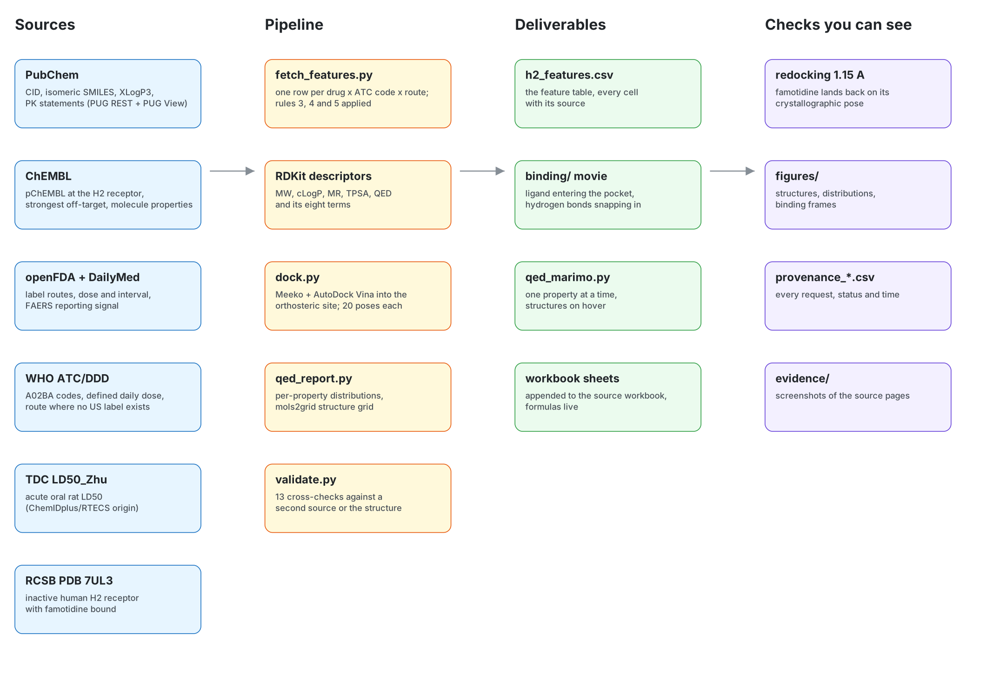

# The H2-receptor antagonists (ATC A02BA)

Five drugs that share one target and one ATC chemical group — cimetidine, ranitidine, famotidine, nizatidine and roxatidine — curated down to one row per route, with a 3D binding movie and a per-property QED view over the curated set. Nothing here replaces anything: `curation/` and `explorer/` are untouched and this folder reads their output.



## What is in here

| Step | Script | Output |
|---|---|---|
| Features, one row per drug x ATC code x route | `fetch_features.py` | `data/h2_features.csv`, `data/h2_features.json`, `data/provenance_features.csv` |
| Docking into the H2 receptor and the movie's data | `dock.py` | `data/binding.json`, `data/docking.csv`, `data/provenance_docking.csv` |
| The binding movie | `binding/index.html` | a page: ligand entering the pocket, hydrogen bonds forming |
| QED one property at a time | `qed_marimo.py` (notebook), `qed_report.py` (static) | `figures/qed_*.png`, `figures/h2_grid.html`, `data/qed_table.csv` |
| Cross-checks | `validate.py` | `data/validation.md` |
| Screenshots of the source pages | `evidence_shots.py` | `figures/evidence/` |
| The workbook with these sheets appended | `write_workbook.py` | an `.xlsx` beside the source one |
| This diagram | `make_diagram.py` | `figures/h2_workflow.excalidraw`, `.svg`, `.png` |

## Run it

```bash
pip install -r h2/requirements.txt
python h2/fetch_features.py --out h2/data --cache .h2_cache
python h2/dock.py --out h2/data --cache .h2_cache --work .h2_dock     # needs Open Babel on PATH
python h2/qed_report.py --out h2
python h2/validate.py --out h2
python h2/evidence_shots.py --out h2/figures/evidence --serve          # optional, needs Playwright
cd h2 && python -m http.server 8777                                    # then open /binding/
marimo edit h2/qed_marimo.py                                           # the interactive QED notebook
```

Every HTTP request goes through one cached helper, so a second run is offline and gives the same table, and `data/provenance_*.csv` lists every URL, status and time.

## How the three questions in the ask were answered

**Several routes per drug.** Each route is its own row (rule 5), so a drug with an oral and an intravenous product appears twice and everything that depends on the route — bioavailability, dose, dose interval, the free drug concentration — differs between the rows while the structure-derived columns stay the same. At most two non-intravenous routes are kept (rules 3 and 4); intravenous rows are kept beyond that cap, because the comparison the ask is built on (dose-corrected bioavailability as a toxicity flag) needs the route where absorption is complete by definition. Famotidine is the drug where this shows: oral F = 0.45 against 1.0 intravenous, and the therapeutic index moves from 3.93 to 4.24 on the same structure.

**Therapeutic index.** `= LOG(in vivo toxicity) - LOG(1 / in vivo activity)` exactly as asked, written as a live spreadsheet formula rather than a pasted number. In vivo toxicity is the acute oral rat LD50 (mg/kg) from the Therapeutics Data Commons `LD50_Zhu` set, which carries the ChemIDplus/RTECS measurements. In vivo activity is 1 / (label dose in mg per 70 kg adult) for that route, or the WHO defined daily dose where no US label exists. Both are animal or label values, so the index compares these five drugs with each other; it is not a clinical safety margin.

**In vivo free drug concentration.** The workbook's own formula is kept, `1.44 * F * t½ * dose / interval`, and the four inputs are filled per route.

## Where each column comes from

| Column group | Source | Note |
|---|---|---|
| CID, SMILES, XLogP3, PK statements | PubChem PUG REST and PUG View | SMILES are PubChem only, canonicalised with RDKit |
| MW, cLogP, MR, TPSA, HBD, HBA, rotatable bonds, aromatic rings, QED and its eight terms | RDKit, from the PubChem SMILES | recomputed in `validate.py` from the stored SMILES |
| Routes | openFDA drug label counts, DailyMed SPL fallback, WHO ATC/DDD where neither has a US label | the counts behind the choice are in the row |
| In vitro activity | ChEMBL pChEMBL at CHEMBL1941 | falls back to an H2 ortholog, or to a nanomolar `standard_value` where ChEMBL stores no pChEMBL, and says which |
| In vitro toxicity | ChEMBL: the strongest median pChEMBL at any non-H2 target | hERG is reported separately; ChEMBL holds no hERG value for these five |
| In vivo toxicity | TDC `LD50_Zhu` (acute oral rat LD50) | roxatidine is not in the set, so that cell is empty with the reason |
| Bioavailability, half-life, dose, interval | the label for that route, PubChem PUG View for PK statements | half-life is the median over every statement found, with the statements listed |
| Primary toxicity endpoint | openFDA FAERS most reported reaction | a reporting signal, never an incidence rate |
| Docking columns | AutoDock Vina 1.2.5 into PDB 7UL3 | see below |

A cell is empty only when no source answered, and the `_source` column next to it says what was tried.

## The binding movie

`binding/index.html` plays one ligand at a time entering the orthosteric pocket of **PDB 7UL3**, the inactive human H2 receptor solved with famotidine bound. What is measured: the receptor backbone and pocket residues as they sit in the structure, the docked pose, the Vina score, the residues within 4 Å and every hydrogen bond under 3.5 Å, which fade in over the last fifth of the run. What is drawn for the eye: the path the ligand takes, a smoothstep glide along the receptor's own extracellular axis that ends exactly on the docked pose. It is not a trajectory and no energy is computed along it.

Pose selection is the same rule for all five: the best-scoring pose whose centroid sits within 5 Å of the crystallographic famotidine, because the 24 Å box also covers the extracellular vestibule and Vina's top pose sometimes parks there. The check that this is honest is famotidine itself: redocked, its selected pose is **1.15 Å** from the experimental pose (the closest of the twenty poses is 0.99 Å). All five poses touch Asp98, the conserved aspartate that anchors aminergic ligands.

Docking is rigid-receptor and the scores land within 1.5 kcal/mol of each other, which is inside Vina's own error, so the ranking between these five is not evidence of relative potency. Use the ChEMBL pChEMBL column for that.

## Reading the QED view

QED is one number built from eight desirability functions, so a low QED hides which term caused it. `figures/qed_distributions.png` puts the five drugs on each term's distribution over the 756 curated drugs, and `figures/qed_terms_heatmap.png` shows the terms per drug with the raw values in the cells. Cimetidine's QED of 0.23 (17th percentile) is driven by its five structural alerts, not by size or lipophilicity; roxatidine's 0.72 comes with a single alert. The marimo notebook does the same interactively, with structures on hover through `marimo_chem_utils` and a mols2grid panel.
